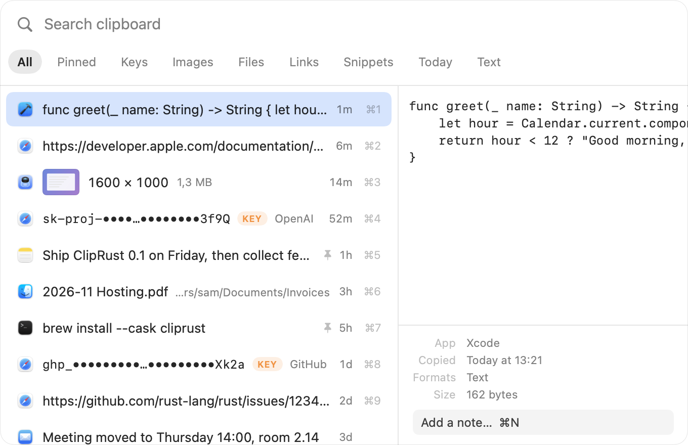

# ClipRust

A fast, low-memory clipboard history for macOS. A Rust core handles capture, storage and search; a native SwiftUI app sits on top.

<picture>
  <source media="(prefers-color-scheme: dark)" srcset="docs/images/panel-dark.png">
  
</picture>

## Features

### Find things

- **Search everything.** Full-text search over all history, not only previews.
- **Search by app.** Type `mail` or `codex` to filter by the app you copied from, or use `from:mail`.
- **Phone numbers, emails, addresses.** Recognised in short clips; type `phone`, `email` or `address` (or `is:phone`), or use the Contacts chip, then call, mail or map them from the row menu.

### Organise

- **Lists.** Manual lists, saved searches, pinned items. Jump between them from the keyboard.
- **Keyboard first.** ← and → walk the filter chips, ⌘N labels the selected clip with a note right in the list (handy for keys), and every panel shortcut can be changed in Settings → Shortcuts.

### Capture and privacy

- **Keys stay hidden.** API keys and tokens are recognised, masked everywhere, and revealed only after Touch ID. Copied keys are marked so other clipboard managers skip them.
- **Respects privacy.** Skips content that password managers mark as concealed, and any apps you exclude.
- **Every format.** Plain text, RTF, HTML, images and files, deduplicated and compressed with zstd.
- **Lightweight.** About 17 MB of memory at idle, no helper process, no telemetry, no network access.
- **Imports PasteNow.** Brings over your history and lists.

## Requirements

- macOS 26. Release downloads are built for Apple silicon only.
- To build from source: Xcode 26 and Rust 1.89 or later.

## Install

### Download

1. Download `ClipRust-<version>-macos-arm64.zip` from the [latest release](https://github.com/flix-wg/cliprust/releases/latest) and check it against `SHA256SUMS.txt` (`shasum -a 256 -c SHA256SUMS.txt --ignore-missing`).
2. Unzip it and move `ClipRust.app` to `/Applications`.
3. Releases are not yet signed with an Apple Developer ID, so macOS blocks the first launch. Either open the app once, then choose **Open Anyway** in System Settings → Privacy & Security, or remove the quarantine flag:

   ```sh
   xattr -dr com.apple.quarantine /Applications/ClipRust.app
   ```

Pasting into other apps needs Accessibility permission, which macOS asks for on first use.

### Build from source

```sh
git clone https://github.com/flix-wg/cliprust.git
cd cliprust
app/scripts/build-app.sh        # → app/build/ClipRust.app
```

Set `CLIPRUST_SIGN_IDENTITY` to sign with your own certificate. See [CONTRIBUTING.md](CONTRIBUTING.md) for details.

### CLI

The core also ships as a command-line tool that works on the same database. Install it from the release tarball (`cliprust-<version>-macos-arm64.tar.gz`, then run `xattr -d com.apple.quarantine cliprust` and move it onto your `PATH`) or with Cargo:

```sh
cargo install --git https://github.com/flix-wg/cliprust
```

```sh
cliprust search invoice 2024
cliprust copy 42 --plain
cliprust keys --provider cloudflare
cliprust import-pastenow
```

Run `cliprust --help` for the full list.

## Data and privacy

History lives in `~/Library/Application Support/cliprust/cliprust.db`; the CLI reads another file if you set `CLIPRUST_DB`. Settings live in the `app.cliprust.ClipRust` defaults domain.

ClipRust makes no network connections and collects no telemetry. Nothing leaves your Mac. When key detection is on, it asks the browser in front for the current page's address (Automation permission) so you can tell keys apart later; that address is stored only in the local database.

## Uninstall

1. Turn off **Launch at login** in Settings, then quit ClipRust from the menu-bar icon.
2. Delete the app and, if you want, your data and settings:

   ```sh
   rm -rf /Applications/ClipRust.app
   rm -rf ~/Library/Application\ Support/cliprust
   defaults delete app.cliprust.ClipRust
   tccutil reset Accessibility app.cliprust.ClipRust
   tccutil reset AppleEvents app.cliprust.ClipRust
   ```

3. Remove the CLI with `cargo uninstall cliprust`, or delete the `cliprust` binary you copied onto your `PATH`.

If ClipRust still shows up in System Settings → General → Login Items, remove it there.

## Shortcuts

| Key | Action |
| --- | --- |
| ⇧⌘V | Open the panel |
| ⏎ / ⌥⏎ / ⌘⏎ | Paste / paste as plain text / copy only |
| ⌘1 … ⌘9 | Paste row N |
| ↑ ↓ / ⌃N ⌃P | Move the selection |
| ← → | Previous / next filter (with an empty search, or the caret at its start / end) |
| ⇥ ⇧⇥ / ⌘← ⌘→ | Previous / next filter |
| ⌃1 … ⌃9 | Jump to filter N |
| ⌘L | Go to a list or app |
| ⌘D | Add to list |
| ⌘⇧P | Pin |
| ⌘⇧S | Save search as list |
| ⌘N | Edit the note inline (⏎ saves, Esc cancels, empty removes it) |
| ⌘R | Rename inline |
| ␣ | Quick Look (with an empty search) |
| ⌘⌫ | Delete |
| ⌘P | Show or hide the preview |
| ⌘K | Keys & IDs |
| ⌘, | Settings |
| Esc / ⌘W | Clear the search, then close / close |

The open shortcut and every panel shortcut except ⏎, Esc, ⇥, the arrows, ⌘1–⌘9 and ⌃1–⌃9 can be changed in Settings → Shortcuts. More detail in [docs/app-design.md](docs/app-design.md).

## Layout

```
src/        Rust core: capture, SQLite store, search, rules, key detection, C API
app/        SwiftUI app (Swift package) and build script
docs/       Design notes and roadmap
```

## More

- [CHANGELOG.md](CHANGELOG.md): what changed in each release
- [CONTRIBUTING.md](CONTRIBUTING.md): development setup, checks and releases
- [docs/roadmap.md](docs/roadmap.md): planned features and add-ons

ClipRust is released under the [MIT License](LICENSE).
